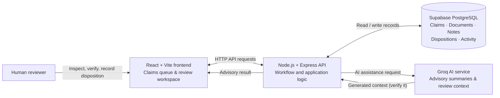

# ClaimPilot

**AI-assisted medical insurance claim review workspace** built with React, Vite, Node.js, Express, Supabase PostgreSQL, and Groq.

ClaimPilot helps a reviewer organize claim submissions, inspect supporting documents, understand AI-generated review assistance, and record workflow progress. It is designed to support—not replace—human judgment.

> **Demo and safety notice:** ClaimPilot is an educational workflow demonstration. Use synthetic sample data only. Do not upload real patient records, protected health information, or other sensitive medical information. AI-generated summaries and suggestions can be incomplete or inaccurate and must be independently verified. ClaimPilot does not make coverage, approval, or rejection decisions.

## What it demonstrates

- Claim queue with search, status/category filters, and queue counts
- Claim review workspace with claim details and supporting documents
- Document verification tracking
- AI-assisted review context and suggested next steps for the human reviewer
- Reviewer notes, activity history, and recorded review disposition
- Review workflow states for requesting more information or marking a claim ready for an insurer decision

**Important distinction:** A recorded review disposition is a workflow status, not an insurance coverage decision. Final decisions remain with the authorized insurer/reviewer.

## Architecture



**Human-in-the-loop boundary:** AI returns advisory context only. The reviewer verifies evidence and records workflow progress. ClaimPilot does not automatically approve or reject insurance claims.

## Technology

| Layer | Technologies |
|---|---|
| Frontend | React, Vite, Tailwind CSS |
| Backend | Node.js, Express |
| Database | Supabase PostgreSQL |
| AI assistance | Groq API |

## Repository structure

```text
ClaimPilot/
├── frontend/   # React + Vite application
└── backend/    # Express API and database integration
```

## Run locally

### Prerequisites

- Node.js 20 or later
- npm
- A Supabase project with PostgreSQL
- A Groq API key for AI-assisted features

### 1. Configure the database

Run the SQL setup in `backend/schema.sql` in the Supabase SQL Editor. Then apply the additional migration files in `backend/migrations/` in their intended order, if present. Keep database credentials private.

### 2. Start the backend

```bash
cd backend
npm install
```

Copy `.env.example` to `.env` and populate the required backend environment variables. Do not commit `.env`.

```bash
npm run dev
```

The API health endpoint is expected at `http://localhost:5000/api/health` for the local configuration.

### 3. Start the frontend

In a second terminal:

```bash
cd frontend
npm install
```

Copy `.env.example` to `.env` and set the API base URL to your backend (for a standard local setup, `http://localhost:5000/api`).

```bash
npm run dev
```

Open the local URL printed by Vite (commonly `http://localhost:5173`).

## Environment and secrets

Use `frontend/.env.example` and `backend/.env.example` as the configuration references. Never commit API keys, database passwords, JWT secrets, or real user data. Server-side credentials—including the Groq key and database connection string—must remain on the backend.

## Demo walkthrough

1. Open the claims queue and point out the search, filters, and status counts.
2. Select a synthetic sample claim to open its review workspace.
3. Review the claim information and supporting documents; demonstrate document verification.
4. Show the AI-assisted review context and explain that it is advisory and must be checked.
5. Add a reviewer note and show the activity history.
6. Record a review disposition, return to the queue, and demonstrate that the workflow status is visible.
7. Emphasize that ClaimPilot records review progress; it does not approve or deny coverage.

## Current scope and limitations

- Demonstration workflow using synthetic data; not production-ready for real medical or insurance records.
- AI output may be wrong, incomplete, or misleading and requires human verification.
- Review disposition represents workflow progress only, not a final claim decision.
- Production use would require a comprehensive security, privacy, access-control, audit, reliability, and regulatory review.

## Responsible use

Use synthetic sample documents only. Do not treat AI output as medical, legal, or insurance advice. An authorized human reviewer is responsible for verifying evidence and making any insurer decision.
